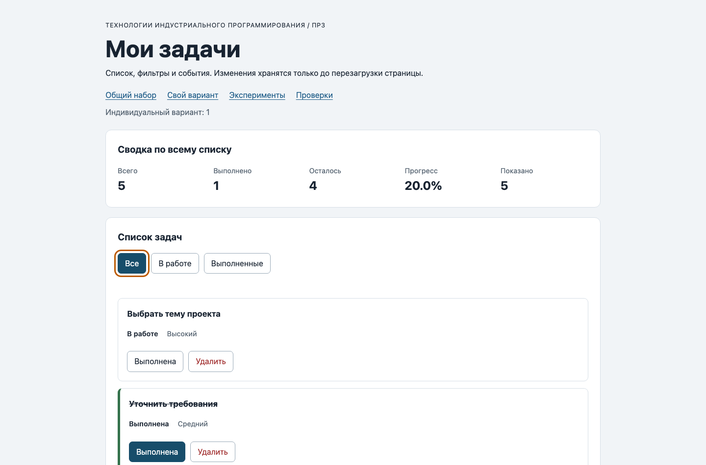

# Практическая работа № 3

**Тема:** работа с DOM и событиями.  
**Автор:** AntonXer.  
**Вариант:** 1 по номеру 33 в журнале. Расчёт: `((33 - 1) % 8) + 1 = 1`.

## Цель и результат

Создать интерфейс списка задач на JavaScript, подключить изменение статуса и удаление, показать три фильтра и сводку. Проверки сервиса и интерфейса прошли. После перезагрузки восстанавливается исходный набор задач.

## Окружение и запуск

ОС — macOS 27.2.1. Сервис проверен на Node.js 24.22.1 из VS Code. Интерфейс и отладка проверены в Chromium 140.0.7339.225, встроенном в Qt WebEngine. Повторная проверка штатного сервера на Node.js v24.22.3 подтвердила 35 проверок сервиса и 36 браузерных проверок.

Из папки `practice-03`:

```sh
node checks/service.checks.js
node tools/serve.mjs
```

С npm доступны эквивалентные команды `npm run check:service` и `npm start`. Установка пакетов не требуется. После запуска откройте нужный адрес:

- Общий набор — http://127.0.0.1:5503/
- Вариант 1 — http://127.0.0.1:5503/index.html?dataset=variant
- Эксперименты — http://127.0.0.1:5503/examples/dom-events.html
- Проверки интерфейса — http://127.0.0.1:5503/checks.html

Сервер останавливается через Ctrl+C. Для другого порта можно вызвать `node tools/serve.mjs 5504` и заменить порт в адресе.

## Организация кода

| Модуль | Назначение |
|---|---|
| [data.js](src/data.js) | Общий и индивидуальный наборы из ПР2 с прежними ID, названиями, статусами и приоритетами. |
| [task-service.js](src/task-service.js) | Сервис ПР2 без изменений. Ищет, меняет и удаляет задачи, вычисляет статистику по всему списку. |
| [task-selectors.js](src/task-selectors.js) | Возвращает копию списка или выборку по статусу с сохранением порядка. |
| [task-view.js](src/task-view.js) | Создаёт карточки, обновляет список, сводку и сообщения. Названия и ошибки выводятся через `textContent`. |
| [main.js](src/main.js) | Хранит `currentTasks` и `currentFilter`. Обработчики на постоянных контейнерах находят кнопку через `closest()`. После успешной операции обновляются данные, затем DOM и фокус. |

## Эксперименты с DOM

| № | Прогноз | Фактическое наблюдение | Объяснение |
|---:|---|---|---|
| 1 | Отсутствующий элемент — `null`. Длина пустой коллекции — 0. | `null` и `0`. | К свойству результата `querySelector` можно обращаться после проверки на `null`. У пустого `NodeList` доступно свойство `length`. |
| 2 | Атрибут даст строку `"23"`, а `Number()` — число 23. | `"23"` / string, `23` / number. | `dataset` представляет значения атрибутов строками. |
| 3 | После двух добавлений исходная коллекция останется длиной 1, а новый запрос даст 2 и 3. | Сохранённая коллекция — 1 на обоих шагах. Новый запрос — 2, затем 3. | `querySelectorAll()` возвращает статический снимок. |
| 4 | Заголовок покажет теги буквально, вложенных `strong` будет 0. | Отображается `<strong>Это текст, а не HTML</strong>`, вложенных `strong` — 0. | `textContent` записывает строку как текст. |
| 5 | Нажатие по `lab-label` даст фазы 1 → 3 → 3 на контейнере, кнопке и контейнере. | Фазы 1 → 3 → 3. `target` везде `lab-label`, `currentTarget`: `lab-card`, `lab-button`, `lab-card`. | Цель события — вложенный `span`. Кнопка получает событие на всплытии, потому что она его предок. |

Точка останова на строке 25 в [dom-events.js](examples/dom-events.js) подтвердила `event.target.id = "lab-label"`, `event.currentTarget.id = "lab-button"` и `event.eventPhase = 3`.

## Общий сценарий

После списка видимых ID записаны показатели «всего / выполнено / осталось / прогресс / показано».

| Действие | Ожидалось | Получено | Пустое состояние |
|---|---|---|---|
| Исходный набор | `[1, 4, 7, 10]` · 4 / 2 / 2 / 50.0% / 4 | `[1, 4, 7, 10]` · 4 / 2 / 2 / 50.0% / 4 | — |
| Фильтр «В работе» | `[4, 7]` · 4 / 2 / 2 / 50.0% / 2 | `[4, 7]` · 4 / 2 / 2 / 50.0% / 2 | — |
| Выполнить 4 | `[7]` · 4 / 3 / 1 / 75.0% / 1 | `[7]` · 4 / 3 / 1 / 75.0% / 1 | — |
| Фильтр «Все» | `[1, 4, 7, 10]` · 4 / 3 / 1 / 75.0% / 4 | `[1, 4, 7, 10]` · 4 / 3 / 1 / 75.0% / 4 | — |
| Удалить 7 | `[1, 4, 10]` · 3 / 3 / 0 / 100.0% / 3 | `[1, 4, 10]` · 3 / 3 / 0 / 100.0% / 3 | — |
| Фильтр «В работе» | `[]` · 3 / 3 / 0 / 100.0% / 0 | `[]` · 3 / 3 / 0 / 100.0% / 0 | Нет задач по выбранному фильтру. |
| Фильтр «Все», переключить 1 | `[1, 4, 10]` · 3 / 2 / 1 / 66.7% / 3 | `[1, 4, 10]` · 3 / 2 / 1 / 66.7% / 3 | — |
| Удалить 1, 4 и 10 | `[]` · 0 / 0 / 0 / 0.0% / 0 | `[]` · 0 / 0 / 0 / 0.0% / 0 | Список задач пуст. |

После новой загрузки браузерная проверка подтвердила исходные ID `[1, 4, 7, 10]`, активный фильтр «Все» и прогресс `50.0%`.

## Индивидуальный сценарий

Тема варианта — подготовка учебного проекта. Исходные названия из ПР2: «Выбрать тему проекта», «Уточнить требования», «Подобрать примеры», «Составить план работы», «Подготовить прототип», «Оформить список источников». Все шесть задач изначально в работе.

| Действие | Ожидалось | Получено | Пустое состояние |
|---|---|---|---|
| Исходный набор | `[11, 23, 37, 41, 58, 64]` · 6 / 0 / 6 / 0.0% / 6 | `[11, 23, 37, 41, 58, 64]` · 6 / 0 / 6 / 0.0% / 6 | — |
| Фильтр «В работе» | `[11, 23, 37, 41, 58, 64]` · 6 / 0 / 6 / 0.0% / 6 | `[11, 23, 37, 41, 58, 64]` · 6 / 0 / 6 / 0.0% / 6 | — |
| Фильтр «Выполненные» | `[]` · 6 / 0 / 6 / 0.0% / 0 | `[]` · 6 / 0 / 6 / 0.0% / 0 | Нет задач по выбранному фильтру. |
| Фильтр «Все», выполнить 23 | `[11, 23, 37, 41, 58, 64]` · 6 / 1 / 5 / 16.7% / 6 | `[11, 23, 37, 41, 58, 64]` · 6 / 1 / 5 / 16.7% / 6 | — |
| Удалить 37 | `[11, 23, 41, 58, 64]` · 5 / 1 / 4 / 20.0% / 5 | `[11, 23, 41, 58, 64]` · 5 / 1 / 4 / 20.0% / 5 | — |
| Фильтр «В работе» | `[11, 41, 58, 64]` · 5 / 1 / 4 / 20.0% / 4 | `[11, 41, 58, 64]` · 5 / 1 / 4 / 20.0% / 4 | — |
| Фильтр «Выполненные» | `[23]` · 5 / 1 / 4 / 20.0% / 1 | `[23]` · 5 / 1 / 4 / 20.0% / 1 | — |

## Отладка обработчика

В Chromium DevTools установлены три точки останова в [main.js](src/main.js). Нажатие по вложенной подписи задачи 4:

| Строка | Фактическое значение |
|---:|---|
| 48 | `event.target.tagName = "SPAN"`, `event.currentTarget.id = "task-list"`, `card.dataset.taskId = "4"` (string), `action = "toggle"`. |
| 61 | `id = 4` (number). Найдена задача «Подготовить модель задач» с `completed: false` и приоритетом `high`. |
| 64 | `result.ok = true`. В новом массиве пары ID и статуса: `[1, true]`, `[4, true]`, `[7, false]`, `[10, true]`. До присваивания результата текущая задача 4 ещё имеет `completed: false`. |

Проверка клавиатуры в Chromium: Tab перевёл фокус с «Удалить» у задачи 1 на кнопку статуса задачи 4. Enter отметил задачу выполненной и сохранил фокус на её кнопке. Space вернул статус «В работе». Следующие Tab и Enter удалили задачу 4, после чего фокус перешёл на активный фильтр «Все», а общее число задач стало 3.

## Собственные проверки

| Исходное состояние и действия | Ожидание | Получено | Итог |
|---|---|---|---|
| Общий набор. В DOM подставить по очереди ID `777` и `4abc`, нажать вложенные подписи. Затем выбрать «Все». | Два отказа. Статистика сохраняется. Корректный фильтр очищает ошибку и возвращает настоящий ID. | Выведены причина отсутствия 777 и причина некорректности `4abc`. Всего 4 задачи, прогресс 50.0%. Фильтр очистил ошибку, задача 4 осталась в работе. | Пройдено |
| Семь раз сменить «В работе» на «Все», затем трижды подряд переключить статус задачи 4 через вложенную подпись. | Три одиночных изменения. Конечный статус противоположен исходному. | Из «В работе» перешла в «Выполнена», прогресс 75.0%. | Пройдено |
| Оставить одну выполненную задачу. Включить «В работе», затем «Выполненные» и удалить последнюю задачу. | Два разных пустых состояния. После удаления — нулевая сводка и фокус на активном фильтре. | Сначала «Нет задач по выбранному фильтру.» при прогрессе 100.0%. Затем «Список задач пуст.» при 0.0% и фокус на «Выполненные». | Пройдено |

## Вид приложения



## Протокол проверки сервиса

```text
OK: 01. Создание задачи с явным приоритетом
OK: 02. Приоритет по умолчанию
OK: 03. Удаление краевых пробелов без изменения внутренних
OK: 04. Граничные длины названия и положительный безопасный id
OK: 05. Некорректные названия при создании
OK: 06. Некорректные идентификаторы при создании
OK: 07. Все допустимые приоритеты и отклонение недопустимых
OK: 08. Каждый вызов createTask возвращает новый объект
OK: 09. Поиск по id, а не по индексу
OK: 10. Отсутствующая задача и пустой массив при поиске
OK: 11. Поиск не преобразует строковый id в число
OK: 12. Получение невыполненных задач
OK: 13. Пустой список, все выполнены и все не выполнены
OK: 14. Названия в исходном порядке и пустой список
OK: 15. Сводка по общему набору
OK: 16. Сводка по пустому списку
OK: 17. Сводка: ничего не выполнено и выполнено всё
OK: 18. Процент остаётся числом без предварительного округления
OK: 19. Добавление в конец без изменения входного массива
OK: 20. Добавление в пустой список с приоритетом по умолчанию
OK: 21. Повторяющийся id отклоняется
OK: 22. Добавление не обходит проверки createTask
OK: 23. Изменение completed в обе стороны
OK: 24. completed принимает только boolean
OK: 25. Некорректный или отсутствующий id при изменении статуса
OK: 26. Повторная установка статуса создаёт новый результат
OK: 27. Переименование сохраняет остальные поля
OK: 28. Проверки названия при переименовании
OK: 29. Некорректный или отсутствующий id при переименовании
OK: 30. Удаление по id с сохранением порядка
OK: 31. Удаление единственной записи
OK: 32. Некорректный, отсутствующий id и удаление из пустого списка
OK: 33. Входные объекты не изменяются ни одной операцией
OK: 34. Общий сценарий и все промежуточные сводки
OK: 35. Работа с другим набором, без зависимости от demoTasks

Проверок пройдено: 35; не пройдено: 0.
```

## Протокол браузерных проверок

```text
OK: Фильтр all возвращает новый массив в исходном порядке
OK: Фильтр pending выбирает невыполненные задачи
OK: Фильтр completed выбирает выполненные задачи
OK: Все три фильтра работают с пустым списком
OK: Фильтрация не меняет входные записи и их порядок
OK: Карточка — li.task-card с числовым id в dataset
OK: Статус невыполненной карточки и aria-pressed согласованы
OK: Статус выполненной карточки и aria-pressed согласованы
OK: В карточке две обычные кнопки с вложенными подписями
OK: Все приоритеты отображаются по установленному словарю
OK: Название с разметкой отображается текстом
OK: Отрисовка списка создаёт карточки в исходном порядке
OK: Повторная отрисовка не накапливает карточки
OK: Контейнер списка и его обработчик сохраняются
OK: Отрисовка пустого массива очищает прежние карточки
OK: Сводка считается по всему списку, отдельно выводится Показано
OK: Пустая сводка не содержит NaN и Infinity
OK: Сообщение для полностью пустого списка
OK: Сообщение для пустого результата фильтра
OK: Появление карточек скрывает прежнее пустое состояние
OK: Приложение: начальный набор и сводка
OK: Приложение: фильтр срабатывает по клику на вложенный span
OK: Приложение: активный фильтр отмечен классом и aria-pressed
OK: Приложение: фильтрация не удаляет скрытые задачи
OK: Приложение: переключение по id, а не индексу массива
OK: Приложение: выполненная задача исчезает из фильтра В работе
OK: Приложение: удаление изменяет данные, а не только DOM
OK: Приложение: клик по названию не изменяет данные
OK: Приложение: после перерисовок одно нажатие — одно изменение
OK: Приложение: удаление всех записей и нулевая сводка
OK: Приложение: нет совпадений — не то же самое, что нет задач
OK: Приложение: неизвестный числовой id не меняет данные
OK: Приложение: id 4abc не превращается в 4
OK: Приложение: неизвестное действие игнорируется
OK: Приложение: после изменения сохраняется клавиатурный фокус
OK: Приложение: новая загрузка возвращает исходное состояние

Всего: 36. Пройдено: 36. Ошибок: 0.
```

## Вывод

Сервис меняет состояние задачи, а функции представления отражают это состояние в DOM. Делегирование на контейнере сохраняет обработчик после замены карточек. Фильтр меняет видимую выборку, поэтому общий прогресс остаётся одинаковым при переключении между фильтрами.

[Методичка ПР3](https://github.com/dmgimatdinov/TIP-JS/blob/main/practices/practice-03/README.md)
